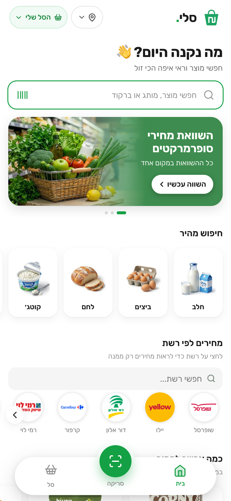
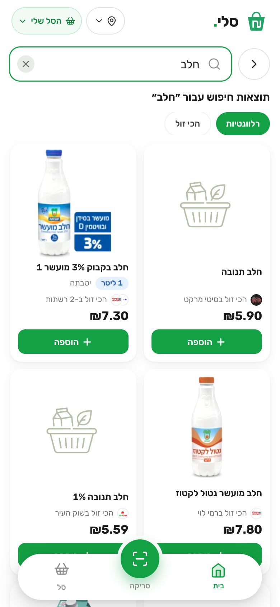
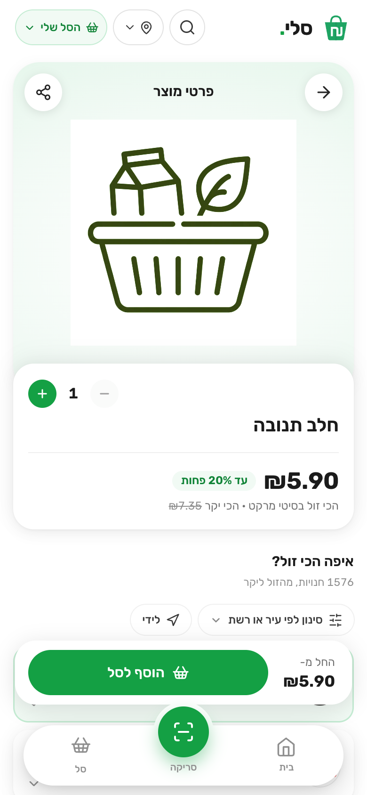

# Sali (סלי): Israeli supermarket price comparison

Search a product or build a shopping basket, and see which store is cheapest. Sali loads the public price files that
Israeli supermarket chains are required by law to publish, twice a day, and compares them in a fast, mobile-first
Hebrew (right-to-left) web app.

**Live:** http://82.70.214.11 (a custom domain with HTTPS is on its way)

| | | |
|:-:|:-:|:-:|
|  |  |  |

- **29 chains, about 2,000 stores, 240,000 products**, refreshed at 06:00 and 18:00 Israel time.
- **Basket comparison:** the total of a whole basket per store, cheapest first, with store promotions applied where the
  data lets us do it safely.
- **Deals:** only promotions that really are cheaper than the cheapest shelf price we know of the same product.
- **Near me:** distance-ordered stores, from the browser's position or a chosen city.
- **Barcode scanner** in the browser (camera), for comparing a product while standing in the aisle.
- No sign-up, no cookies, no tracking. Baskets live in the browser's local storage.

## How it works

```
chains' price portals ─► worker ─► PostgreSQL ◄─ FastAPI (read-only role) ◄─ nginx ◄─ React app
                       scrape → parse → delete                                  (Caddy adds HTTPS)
```

| Part | What it does |
|---|---|
| `app/scraper`, `app/parser` | Downloads each chain's price (and promotion) files, checks that the XML is complete, and loads it with set-based SQL in chunks of 500 rows. One transaction per file, together with its row in a **file ledger**, so a crash can never leave a file half-loaded or marked loaded without its data. |
| `app/worker.py`, `app/pipeline` | The scheduler: two cycles a day, one subprocess per chain with a timeout, so one failing chain never stops the others. A Postgres advisory lock allows one cycle at a time. Also fills in product pictures, store locations and the materialized deal view after each cycle. |
| `app/api` | FastAPI, fully async (`asyncpg`). Search, compare, basket, deals, health. Connects with a **read-only database role**. |
| `app/basket_promos.py` | The promotion engine: prices a basket with "N for X" promotions, single-product and multi-product, picking the largest saving first and the cheapest units first. Verified against a slow reference implementation on random baskets. |
| `frontend/` | React + TypeScript + Vite, hand-written CSS (RTL), route-level code splitting. |
| `deploy/`, `nginx/`, `docker-compose.yml` | One small VPS in Israel (several chains only answer Israeli addresses): db, api, worker, backup, nginx, and optional Caddy for HTTPS. |

### Decisions worth a look

- **Price history without waste.** Each price row has `is_current`; a partial unique index allows exactly one current row
  per `(store, product)`. A changed price closes the old row and inserts a new one; an unchanged price writes
  *nothing* (a full file just stamps the store). That took a price cycle from 6+ hours to 20-30 minutes.
- **Files are deduplicated by name in two places** (the scraper's status store and the ledger), never by what is on
  disk, which is what makes deleting loaded XML safe.
- **Money is `Decimal` / `Numeric(10, 2)`** everywhere, never `float`.
- **Honest deals.** A deal appears only if it is 10-60% cheaper than the cheapest shelf price among the chains we hold,
  its store's promotion data is under a week old, and the price is confirmed by the promotion's own text. Everything
  else stays display-only.
- **Hebrew search that forgives typos:** `pg_trgm` GIN index for substring search, with a trigram-similarity fallback
  that is skipped for keyboard-smash queries.
- **Careful with pictures:** a product picture is shown only if the source's own code matches the barcode, or the names
  agree word for word (a corn once got a mayonnaise's picture).
- **Operations included:** `/health` and `/health/data` for uptime monitors, healthchecks.io pings from the worker and
  the backup job, nightly `pg_dump` (plus a script that copies it off the server), a watchdog for chains that stop loading, capped container logs.

## Run it locally

Needs Python 3.11+, Node 20+ and PostgreSQL 16 (with the `pg_trgm` extension).

```bash
cp .env.example .env            # set DATABASE_URL=postgresql+asyncpg://...
python -m venv venv && venv/bin/pip install -r requirements.txt
venv/bin/python -m alembic upgrade head

venv/bin/python -m app.worker --once --chains SHUFERSAL   # load one chain's prices
venv/bin/uvicorn main:app --reload                        # API on :8000

cd frontend && npm ci && npm run dev                      # app on :3000, proxies /api
```

Tests (create and drop a throw-away database, `sm_pytest`):

```bash
venv/bin/python -m pytest        # 346 tests: parsing, loading, promotions, API, migrations, worker
cd frontend && npm run build     # type-check + production build
```

CI (GitHub Actions) runs both on every pull request.

## Deploy

```bash
docker compose up -d --build     # db, migrate, api, worker, backup, frontend, nginx
```

HTTPS, backups, monitoring and the server notes are in [docs/deployment.md](docs/deployment.md); the architecture
write-up is in [docs/hld-cloud-architecture.md](docs/hld-cloud-architecture.md).

## Known limits

- Prices are a snapshot of what chains publish: club prices, in-store specials and stock are not covered. The site says so.
- Only part of the catalogue has pictures (Shufersal's catalogue and Open Food Facts).
- One chain (Super-Pharm) blocks the server's address; it is left out.
- Front-end dev dependencies (Vite / esbuild) and `react-router` 6 have open advisories that only matter for a
  development server or server-side rendering, neither of which this app uses; the upgrades are breaking and planned.
- No end-to-end browser tests yet; the front end is covered by type-checking and the production build.

## Data, credits and licence

- Prices come from the public files the chains publish under Israel's price-transparency rules. Sali is not affiliated
  with any chain. Logos belong to their owners.
- Downloading and parsing use [israeli-supermarket-scarpers](https://github.com/OpenIsraeliSupermarkets/israeli-supermarket-scarpers)
  and [israeli-supermarket-parsers](https://github.com/OpenIsraeliSupermarkets/israeli-supermarket-parsers), which are
  licensed for non-commercial use, so Sali is a non-commercial project.
- Pictures: Shufersal's public catalogue and [Open Food Facts](https://world.openfoodfacts.org) (CC BY-SA).
- Store locations: OpenStreetMap Nominatim.
- The source is public for review. No open-source licence has been granted yet.
